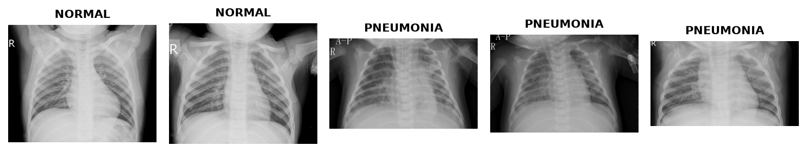

Chest X-Ray (Pneumonia)
=======================

.. raw:: html

   

   
   
   
   

Overview
--------

The Chest X-Ray Images (Pneumonia) dataset consists of 5,856 validated anterior-posterior chest radiographs collected from pediatric patients aged one to five years old at Guangzhou Women and Children's Medical Center. All radiographs were screened for quality control and graded by two expert physicians.

- **Train**: 5,216 images
- **Validation**: 16 images
- **Test**: 624 images

All images are converted to 3-channel RGB format for unified compatibility with standard vision backbones.

Data Structure
--------------

When accessing an example using ``ds[i]``, you receive a dictionary with the following keys:

.. list-table::
   :header-rows: 1
   :widths: 20 25 55

   * - Key
     - Type
     - Description
   * - ``image``
     - ``PIL.Image.Image``
     - Chest radiograph in RGB format
   * - ``label``
     - int
     - Class index: ``0`` (NORMAL) or ``1`` (PNEUMONIA)

Classes
-------

.. list-table::
   :header-rows: 1
   :widths: 20 80

   * - Label
     - Class Name
   * - 0
     - **NORMAL** - Clear chest radiograph with no signs of pneumonia
   * - 1
     - **PNEUMONIA** - Chest radiograph exhibiting bacterial or viral pneumonia

Usage Example
-------------

.. code-block:: python

    from stable_datasets.images import ChestXRay

    # Load validation split
    ds = ChestXRay(split="validation")
    sample = ds[0]

    print(sample.keys())          # dict_keys(["image", "label"])
    print(type(sample["image"]))  # PIL.Image.Image
    print(sample["label"])        # 0 or 1

    # Load as PyTorch tensors
    ds_torch = ds.with_format("torch")
    torch_sample = ds_torch[0]
    print(torch_sample["image"].shape)  # 3 x H x W

Citation
--------

.. code-block:: bibtex

    @article{kermany2018identifying,
        title={Identifying medical diagnoses and treatable diseases by image-based deep learning},
        author={Kermany, Daniel S and Goldbaum, Michael and Cai, Wenjia and Valentim, Carolina CS and Liang, Huiying and Baxter, Sally L and McKeown, Alex and Yang, Ge and Wu, Xiaokang and Yan, Fangbing and others},
        journal={Cell},
        volume={172},
        number={5},
        pages={1122--1131},
        year={2018},
        publisher={Elsevier}
    }
